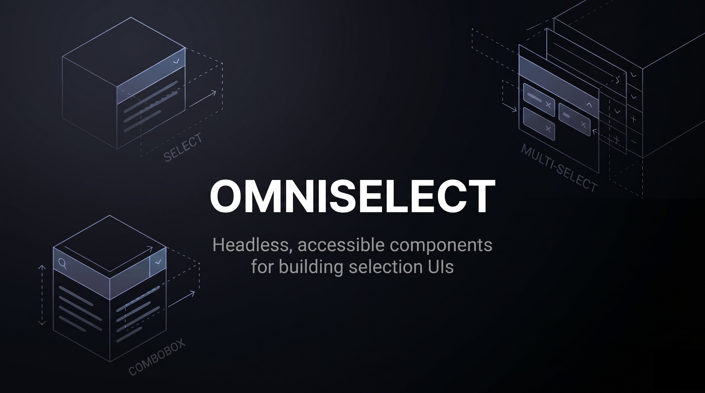

# @zealakit/omniselect-core

[English](https://github.com/zealakit/omniselect/blob/main/packages/core/README.md) | [Tiếng Việt](https://github.com/zealakit/omniselect/blob/main/packages/core/README_VI.md) | [中文](https://github.com/zealakit/omniselect/blob/main/packages/core/README_CN.md)



Logic nội bộ cho selection, collection, điều hướng bàn phím và lọc của mọi adapter Zealakit Omniselect. Core là package private và không bao giờ được publish lên npm: mỗi adapter đóng gói sẵn một bản core riêng, nên code ứng dụng dùng adapter của framework. Tài liệu này dành cho người đóng góp phát triển các adapter trong monorepo.

Core không render gì và không kèm CSS. Core không có runtime dependency và không bao giờ import framework hay Overlay.

> **Note**
> Omniselect là bộ primitive headless tập trung cho Select và Combobox, xây dựng trên Zealakit Overlay. Không kèm CSS và không render markup có kiểu dáng, nên mọi quyết định visual đều thuộc về bạn. Virtualization, tùy chọn do người dùng tạo và component tag dựng sẵn chưa được triển khai.
>
> Omniselect không phải là bản thay thế cho một UI library hay design system đầy đủ. Hãy dùng khi bạn cần các primitive chọn giá trị có accessibility mà không phải kéo theo một bộ UI lớn, hoặc khi select trong thư viện hiện tại khó restyle.

## Install

```bash
pnpm --filter @zealakit/omniselect-core run build
```

Core không có trên npm nên không thể cài. Core được build trong workspace và, khi release, được chép vào tarball của từng adapter tại `dist/vendor/core`. State dùng chung toàn trang nằm trên `globalThis`, nên nhiều adapter trên cùng một trang vẫn dùng chung. Không có peer dependency và không có runtime dependency.

## Public API

| Export | Purpose |
| --- | --- |
| `getGlobalState(name, create)` | State dùng chung toàn trang cho mọi bản core được đóng gói, lưu trên `globalThis` dưới khóa `Symbol.for` có version. |

Hiện chỉ có helper state dùng chung được export. Các module selection, collection và điều hướng sẽ xuất hiện cùng các bản release component.

## License

MIT © Zealakit
