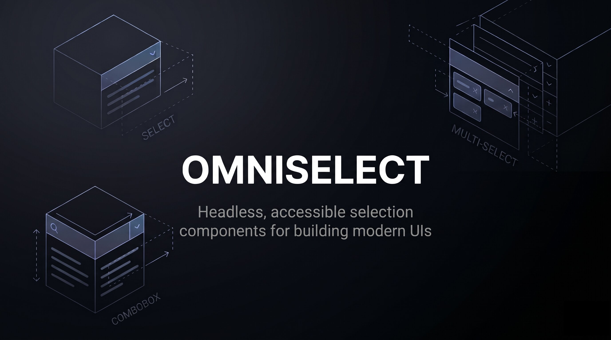

# @zealakit/omniselect-svelte

[English](https://github.com/zealakit/omniselect/blob/main/packages/svelte/README.md) | [Tiếng Việt](https://github.com/zealakit/omniselect/blob/main/packages/svelte/README_VI.md) | [中文](https://github.com/zealakit/omniselect/blob/main/packages/svelte/README_CN.md)



Headless Select and Combobox for Svelte. You own visual styling.

Style the parts with your own CSS and `data-*` state attributes. Omniselect ships no CSS, icons, or animations.

> **Note**
> Omniselect is a focused, headless set of primitives for Select and Combobox, built on Zealakit Overlay. It ships no CSS and renders no styled markup, so you keep full control of the visuals. Virtualization, creatable options, and built-in tag components are not implemented.
>
> Omniselect is not a replacement for a full UI library or design system. Use it when you need accessible selection primitives without adopting a large kit, or when your current library's select is hard to restyle.

## Install

```bash
npm install @zealakit/omniselect-svelte
npm install @zealakit/ui-engine   # peer

# or yarn, pnpm, ...
```

Peer dependency: `svelte` `^5.0.0`. The app already provides it.
`@zealakit/overlay-svelte` is installed automatically as a dependency. The internal `@zealakit/omniselect-core` is bundled inside this package and is not published to npm; there is nothing else to install. ESM only.

## NativeSelect

A semantic `<select>` with a linked label, object values, and native form behavior. Import it from the `/native` entry to keep Overlay out of your bundle.

### Quick start

```svelte
<script lang="ts">
  import { NativeSelect } from "@zealakit/omniselect-svelte/native";

  let fruit = $state("apple");
</script>

<NativeSelect.Root bind:value={fruit} name="fruit">
  <NativeSelect.Label>Fruit</NativeSelect.Label>
  <NativeSelect.Control>
    <NativeSelect.Option value="apple">Apple</NativeSelect.Option>
    <NativeSelect.Option value="banana">Banana</NativeSelect.Option>
  </NativeSelect.Control>
  <NativeSelect.Indicator>▾</NativeSelect.Indicator>
</NativeSelect.Root>
```

### Props

| Prop | Type | Default | Description |
| --- | --- | --- | --- |
| `value` (`bind:value`) | `T \| null` (`T[]` with `multiple`) | — | Controlled value. |
| `defaultValue` | same | `null` (`[]`) | Initial value when uncontrolled. |
| `onValueChange` | `(value) => void` | — | Called on every user change and on form reset. |
| `multiple` | `boolean` | `false` | Selects an array instead of one value. |
| `itemToKey` | `(value: T) => string` | `String` | Maps a value to `<option value>` and to the submitted form value. |
| `name`, `form`, `required`, `disabled`, `autocomplete` | native | — | Forwarded to the `<select>`. |
| `invalid` | `boolean` | `false` | Marks the field invalid from outside, for example a form library's error: sets `data-invalid` and `aria-invalid`. It is not cleared by a change. |
| `children` | `Snippet` | — | The parts. The Root renders no element. |

### Parts

| Part | Element | Notes |
| --- | --- | --- |
| `Root` | none | Owns value, form props, and the option collection. |
| `Label` | `label` | Linked to the control. |
| `Control` | `select` | The only focusable element. Other props are forwarded. |
| `Option` | `option` | `value`, `disabled`, `textValue`. |
| `OptionGroup` | `optgroup` | `label`, `disabled`; disabling it disables its options. |
| `Indicator` | `span` | Decorative slot, `aria-hidden`. |

### Placeholder

Render an option whose value is `null` for the empty state. Its key is `""`, and the control gets `data-placeholder` while it is selected.

## Styling hooks

| Attribute | Where | Purpose |
| --- | --- | --- |
| `data-disabled` | Control, Label, Indicator, Option, OptionGroup | Disabled state. |
| `data-required` | Control, Label | The field is required. |
| `data-invalid` | Control | Set after the browser `invalid` event, cleared on change. |
| `data-placeholder` | Control | A single value is empty. |

## Select

A custom select with a floating popover, built on Overlay. It uses the WAI-ARIA select-only combobox pattern: focus stays on the trigger and the highlighted item is announced through `aria-activedescendant`. Import it from the `/select` entry.

### Quick start

```svelte
<script lang="ts">
  import { Select } from "@zealakit/omniselect-svelte/select";

  let fruit = $state<string | null>("apple");
</script>

<Select.Root bind:value={fruit}>
  <Select.Label>Fruit</Select.Label>
  <Select.Control>
    <Select.Trigger>
      <Select.Value placeholder="Pick a fruit" />
      <Select.Indicator>▾</Select.Indicator>
    </Select.Trigger>
    <Select.Clear>×</Select.Clear>
  </Select.Control>
  <Select.Popover>
    <Select.List>
      <Select.Item value="apple">Apple <Select.ItemIndicator>✓</Select.ItemIndicator></Select.Item>
      <Select.Item value="banana">Banana</Select.Item>
    </Select.List>
  </Select.Popover>
</Select.Root>
```

### Props

| Prop | Type | Default | Description |
| --- | --- | --- | --- |
| `value` (`bind:value`) | `T \| null` | — | Selected value. Controlled when defined. |
| `defaultValue` | `T \| null` | `null` | Initial value when uncontrolled. |
| `onValueChange` | `(value: T \| null) => void` | — | Called when the value changes. |
| `open` (`bind:open`) | `boolean` | — | Controlled open state. |
| `defaultOpen` | `boolean` | `false` | Initial open state. |
| `onOpenChange` | `(open, reason) => void` | — | Called with the new state and a reason: `trigger`, `keyboard`, `select`, `escape`, `tab`, `outside`, `toggle`, `empty`, or `imperative`. |
| `itemToKey` | `(value: T) => string` | `String` | Maps a value to a stable string key. Default `String`. |
| `itemToString` | `(value: T) => string` | `String` | Label for a selected value whose item is not mounted. |
| `disabled`, `required` | `boolean` | `false` | Blocks opening and selecting. |
| `invalid` | `boolean` | `false` | Marks the field invalid from outside, for example a form library's error: sets `data-invalid` and `aria-invalid`. It is not cleared by a change. |
| `closeOnSelect` | `boolean` | `true` | Close after a pick. |
| `allowsEmptyCollection` | `boolean` | `true` | When `false`, the popover does not open while there is nothing to show. |
| `loop` | `boolean` | `false` | Wrap keyboard navigation at the ends. |
| `placement` | `Placement` | `"bottom-start"` | Preferred popover placement. |
| `offset` | `number` | `4` | Gap between the anchor and the popover, in pixels. |
| `matchWidth` | `boolean` | `true` | Set `--omniselect-anchor-width` on the popover. |
| `portal` | `boolean \| Element` | `true` | `true` portals to `document.body`, an element portals there, `false` renders in place. |
| `children` | `Snippet` | — | The parts. The Root renders no element. |

### Parts

| Part | Element | Notes |
| --- | --- | --- |
| `Root` | none | State, ids, and the option collection. |
| `Label` | `span` | Accessible name, referenced by the trigger. |
| `Control` | `div` | Groups trigger and clear; the popover anchors to it. |
| `Trigger` | `button` | `role="combobox"`; toggles the popover and handles the keyboard. |
| `Value` | `span` | Selected label or placeholder. |
| `Clear` | `button` | Resets the selection. Place it beside the trigger. |
| `Indicator` | `span` | Decorative icon, `aria-hidden`. |
| `Popover` | `div` | Floating surface with flip and shift, dismissed by Escape and outside press. |
| `List` | `div` | `role="listbox"`. |
| `Group`, `GroupLabel` | `div` | `role="group"` labelled by its label; `disabled` cascades. |
| `Item` | `div` | `role="option"`; takes `value`, `disabled`, `textValue`. |
| `ItemIndicator` | `span` | Renders only while its item is selected. |
| `Empty` | `div` | Rendered while there is nothing to show. |

| Prop | Type | Default | Description |
| --- | --- | --- | --- |
| `Popover` `forceMount` | `boolean` | `false` | Keep the popover in the DOM (hidden) while closed. |
| `Value` `placeholder` | `string` | — | Shown while nothing is selected. |
| `Clear` `label` | `string` | `"Clear selection"` | Accessible name of the Clear button. |
| `Item` `value`, `disabled`, `textValue` | `T`, `boolean`, `string` | — | Value of the option; the trigger shows its text. Text used for the Value and type-ahead. |

### Keyboard

| Key | Closed | Open |
| --- | --- | --- |
| ArrowDown / ArrowUp | Opens on the selected, first, or last item | Moves the highlight |
| Home / End | Opens on the first / last item | Moves to the first / last item |
| PageDown / PageUp | — | Moves by ten items |
| Enter / Space | Opens | Selects the highlighted item |
| Alt+ArrowUp | — | Selects the highlighted item and closes |
| Tab | — | Selects the highlighted item, closes, and moves focus on |
| Escape | — | Closes and returns focus to the trigger |
| Printable characters | Selects the matching item | Highlights the matching item |
| Backspace / Delete | Clears, when a `Clear` is mounted | — |

### Styling hooks

| Attribute | Where | Purpose |
| --- | --- | --- |
| `data-state` | Trigger, Control, Indicator, Popover, List | `open` or `closed`. |
| `data-placeholder` | Trigger, Value | Nothing is selected. |
| `data-highlighted` | Item | The keyboard or pointer highlight. |
| `data-selected`, `data-state` | Item | Selected (`checked`) or not. |
| `data-disabled` | Root parts, Item, Group | Disabled state. |
| `data-side`, `data-align` | Popover | Resolved placement. |
| `--omniselect-anchor-width` | Popover | Width of the control, for `matchWidth`. |
| `--omniselect-available-height` | Popover | Room left on the popover's side. |

### Combobox

Add `Select.Input` to turn the Select into a searchable combobox (WAI-ARIA editable combobox with list autocomplete). The input takes `role="combobox"` and keeps focus; the trigger becomes a plain button labelled by `triggerLabel`. Items are filtered as the user types.

```svelte
<Select.Root bind:value={fruit} bind:inputValue={query}>
  <Select.Control>
    <Select.Input placeholder="Search fruit" />
    <Select.Trigger><Select.Indicator>▾</Select.Indicator></Select.Trigger>
    <Select.Clear>×</Select.Clear>
  </Select.Control>
  <Select.Popover>
    <Select.List>
      <Select.Item value="apple">Apple</Select.Item>
      <Select.Empty>No results</Select.Empty>
    </Select.List>
  </Select.Popover>
</Select.Root>
```

### Combobox props

| Prop | Type | Default | Description |
| --- | --- | --- | --- |
| `inputValue`, `defaultInputValue` | `string` | `""` | Search text. Controlled when `inputValue` is defined. |
| `onInputChange` | `(text, reason) => void` | — | Reason: `input`, `select`, `clear`, `close`, or `reset`. |
| `filter` | `FilterFn \| false` | contains | Custom `(item, query) => boolean`, or `false` to filter outside (async search). |
| `openOnFocus`, `openOnInput` | `boolean` | `false`, `true` | Open when the input gains focus or while typing. |
| `selectionBehavior` | `"replace-input" \| "keep-input" \| "clear-input"` | `"replace-input"` | What the input shows after a pick. |
| `restoreOnBlur` | `boolean` | `true` | Put the selected label back when the input loses focus. |
| `autoHighlight`, `autoSelectOnTab` | `boolean` | `true`, `false` | Highlight the first match while typing; select the highlight on Tab. |
| `triggerLabel` | `string` | `"Show options"` | Accessible name of the trigger in combobox mode. |

### Combobox keyboard

| Key | Closed | Open |
| --- | --- | --- |
| Typing | Edits the text and opens the list | Filters the items |
| ArrowDown / ArrowUp | Opens on the first / last item | Moves the highlight |
| Alt+ArrowDown | Opens without a highlight | — |
| Enter | Left to the form | Selects the highlighted item |
| Escape | Clears the text | Closes and restores the selected label |
| Tab | — | Closes; selects only with `autoSelectOnTab` |
| Space | Types a space | Types a space |

Filtering is diacritic- and case-insensitive. Filtered-out items stay registered but render nothing, and a group with no match hides itself. During IME composition, keys and filtering wait for the composition to end. The server renders the select-only markup, and the first client effect switches to combobox semantics.

### Popover search

Put `Select.Input` inside `Select.Popover`, above the list, for a search box embedded in the dropdown. The trigger stays a plain select control (placeholder, value, or chips). Opening the popover focuses the input, arrows and Enter work while typing, the box starts empty and clears on every close, and picks never shift it. The input owns `role="combobox"` while the trigger keeps its label and value, Backspace in the box does not remove chips, and focus returns to the trigger on close. In the inline combobox, a press anywhere on the control (not on a button or the input) focuses the input and opens the list. Style the control as one rounded container, use `--omniselect-anchor-width` for the popover width, and make the search box `position: sticky`; the examples show all of this.

```svelte
<Select.Root>
  <Select.Control>
    <Select.Trigger>
      <Select.Value placeholder="Pick a fruit" />
      <Select.Indicator>▾</Select.Indicator>
    </Select.Trigger>
  </Select.Control>
  <Select.Popover>
    <div class="search"><Select.Input placeholder="Search…" /></div>
    <Select.List>
      <Select.Item value="apple">Apple</Select.Item>
      <Select.Empty>No results</Select.Empty>
    </Select.List>
  </Select.Popover>
</Select.Root>
```

### Multiple selection

Set `multiple` to select an array of values. The list stays open after a pick, `Value` joins the labels, and `Value` also exposes the selected items so you can render chips. The pattern is APG's multiselectable listbox: `aria-multiselectable` on the list and `aria-selected` on each item.

```svelte
<Select.Root bind:value={fruits} multiple name="fruits">
  <Select.Control>
    <Select.Trigger>
      <Select.Value placeholder="Pick fruit">
        {#snippet children({ items, remove })}
          {#each items as item (item.key)}
            <span onclick={() => remove(item.value)}>{item.label} ×</span>
          {/each}
        {/snippet}
      </Select.Value>
    </Select.Trigger>
  </Select.Control>
  <Select.Popover>
    <Select.List>
      <Select.Item value="apple">Apple</Select.Item>
      <Select.Item value="banana">Banana</Select.Item>
    </Select.List>
  </Select.Popover>
</Select.Root>
```

### Multiple props

| Prop | Type | Default | Description |
| --- | --- | --- | --- |
| `multiple` | `boolean` | `false` | Select an array of values; `closeOnSelect` defaults to `false`. |
| `maxSelected` | `number` | — | Disable the remaining items once this many are selected. |
| `announce`, `messages` | `boolean`, `{ added, removed }` | `true` | Polite live-region announcements of adds and removes; override the text for i18n. |

### Multiple keyboard

| Key | Closed | Open |
| --- | --- | --- |
| Enter / Space | Opens | Toggles the highlighted item and stays open |
| Shift+ArrowDown / Shift+ArrowUp | — | Moves and adds the item to the selection |
| Ctrl+A / Cmd+A | — | Selects every visible item (without `maxSelected`) |
| Backspace | Removes the last value when the input is empty (combobox) | Removes the last value when the input is empty (combobox) |

### Forms

Setting `name` (or `required`) adds a visually hidden native `<select>` inside the Root, so the value takes part in `<form>` submission, `FormData`, constraint validation, and form reset exactly like a `NativeSelect`. Multiple values submit as repeated entries.

| Prop | Type | Default | Description |
| --- | --- | --- | --- |
| `name`, `form` | `string` | — | Field name and the id of the owning `<form>`. |
| `required` | `boolean` | `false` | Blocks form submission while nothing is selected; the trigger gets `data-invalid` and focus. |
| `value` in FormData | keys | — | Each value is sent as its `itemToKey` string. |

With `Select.Input`, a pick clears the input and keeps the list open by default (`selectionBehavior="clear-input"`). Form reset restores `defaultValue` (controlled: it calls `onValueChange` with it). Autofill through the hidden field maps keys back to values and ignores unknown keys.

### Async loading

`Select.LoadMore` is a sentinel for paginated data. Put it last inside `Select.List`; it calls `onLoadMore` when it scrolls into view (or when the keyboard reaches the last item) while the list is open, `hasMore` is `true`, and `isLoading` is `false`. The library never fetches: you own the request, the page state, and any debouncing.

```svelte
<Select.List>
  {#each items as item (item.id)}
    <Select.Item value={item.id}>{item.name}</Select.Item>
  {/each}
  <Select.LoadMore isLoading={isFetching} hasMore={hasNextPage} onLoadMore={fetchNextPage}>
    Loading…
  </Select.LoadMore>
</Select.List>
```

### LoadMore props

| Prop | Type | Default | Description |
| --- | --- | --- | --- |
| `isLoading` | `boolean` | **required** | A page is being fetched. |
| `hasMore` | `boolean` | **required** | More pages exist. |
| `onLoadMore` | `() => void` | **required** | Fetch the next page. |
| `rootMargin` | `string` | `"0px 0px 64px 0px"` | Prefetch distance around the scroll container. |
| `...div props` | — | — | Forwarded to the sentinel, which is `aria-hidden`. |

### Async hooks

| Attribute | Where | Purpose |
| --- | --- | --- |
| `data-loading` | LoadMore | A page is loading. |
| `data-has-more` | LoadMore | More pages exist. |
| `aria-busy` | List | A page is loading. |

Duplicate requests are blocked while `isLoading` is `true`. When a page finishes and the sentinel is still visible (a short page), the next page loads without another scroll. Items append without moving the highlight, the scroll position, or focus. The list gets `aria-busy` while loading, `Empty` waits until loading ends, and a live region announces progress (override with `messages.loading` and `messages.loaded`). For async search, combine `filter={false}` with `onInputChange` and `LoadMore`; selected values keep their labels through `itemToString`.

### Notes

- Items register while the popover is mounted. Until it opens, a selected value has no label: pass `itemToString`, or set `forceMount` on `Popover` to keep the items registered (this also lets type-ahead work while closed).
- `Popover` stays mounted with `data-state="closed"` until its CSS exit animation finishes, so animate with plain CSS.
- Escape and outside presses go through Overlay's shared layer stack. A Select inside an Overlay `Dialog` closes first on Escape. Inside a modal Dialog, set `portal={false}` (or portal into the dialog content), because a modal marks other body children inert.
- `Clear` and `Indicator` must not sit inside `Trigger`, and `Item`, `Group`, and `Empty` must sit inside `List`; development builds warn otherwise.

## Status

`NativeSelect`, `Select` (single, multiple, forms), combobox search, and async loading (`Select.LoadMore`) are available. The package also exports the Overlay types below.

| Export | From |
| --- | --- |
| `DismissReason` (type) | `@zealakit/overlay-svelte` |
| `Placement` (type) | `@zealakit/ui-engine/position` |

## Agent Skill

- [Omniselect Svelte](https://github.com/zealakit/omniselect/blob/main/skills/omniselect-svelte.md) — install and import rules for Svelte.

## License

MIT © Zealakit
