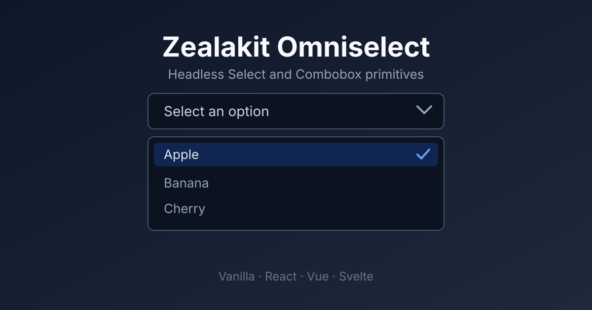

# @zealakit/omniselect-svelte

[English](https://github.com/zealakit/omniselect/blob/main/packages/svelte/README.md) | [Tiếng Việt](https://github.com/zealakit/omniselect/blob/main/packages/svelte/README_VI.md) | [中文](https://github.com/zealakit/omniselect/blob/main/packages/svelte/README_CN.md)



Select và Combobox headless cho Svelte. Bạn tự quyết định style hiển thị.

Style các phần bằng CSS của bạn và các thuộc tính trạng thái `data-*`. Omniselect không kèm CSS, icon hay animation.

> **Note**
> Omniselect là bộ primitive headless tập trung cho Select và Combobox, xây dựng trên Zealakit Overlay. Không kèm CSS và không render markup có kiểu dáng, nên mọi quyết định visual đều thuộc về bạn. Tải dữ liệu bất đồng bộ, virtualization, tùy chọn do người dùng tạo và tag input chưa được triển khai.
>
> Omniselect không phải là bản thay thế cho một UI library hay design system đầy đủ. Hãy dùng khi bạn cần các primitive chọn giá trị có accessibility mà không phải kéo theo một bộ UI lớn, hoặc khi select trong thư viện hiện tại khó restyle.

## Install

```bash
npm install @zealakit/omniselect-svelte

# or yarn, pnpm, ...
```

Peer dependency: `svelte` `^5.0.0`. Ứng dụng đã có sẵn.
`@zealakit/overlay-svelte` được cài tự động như một dependency. `@zealakit/omniselect-core` nội bộ được đóng gói sẵn trong package này và không được publish lên npm; không cần cài thêm gì khác. Chỉ hỗ trợ ESM.

## NativeSelect

`<select>` ngữ nghĩa có label liên kết, giá trị dạng object và hành vi form gốc. Hãy import từ entry `/native` để bundle của bạn không kéo theo Overlay.

### Quick start

```svelte
<script lang="ts">
  import { NativeSelect } from "@zealakit/omniselect-svelte/native";

  let fruit = $state("apple");
</script>

<NativeSelect.Root bind:value={fruit} name="fruit">
  <NativeSelect.Label>Fruit</NativeSelect.Label>
  <NativeSelect.Control>
    <NativeSelect.Option value="apple">Apple</NativeSelect.Option>
    <NativeSelect.Option value="banana">Banana</NativeSelect.Option>
  </NativeSelect.Control>
  <NativeSelect.Indicator>▾</NativeSelect.Indicator>
</NativeSelect.Root>
```

### Props

| Prop | Type | Default | Description |
| --- | --- | --- | --- |
| `value` (`bind:value`) | `T \| null` (`T[]` with `multiple`) | — | Giá trị được điều khiển. |
| `defaultValue` | same | `null` (`[]`) | Giá trị ban đầu khi không điều khiển. |
| `onValueChange` | `(value) => void` | — | Được gọi ở mỗi thay đổi của người dùng và khi reset form. |
| `multiple` | `boolean` | `false` | Chọn một mảng thay vì một giá trị. |
| `itemToKey` | `(value: T) => string` | `String` | Ánh xạ giá trị sang `<option value>` và giá trị form được gửi đi. |
| `name`, `form`, `required`, `disabled`, `autocomplete` | native | — | Được chuyển tiếp tới `<select>`. |
| `children` | `Snippet` | — | Các part. Root không render phần tử nào. |

### Parts

| Part | Element | Notes |
| --- | --- | --- |
| `Root` | không có | Giữ giá trị, các prop của form và tập hợp option. |
| `Label` | `label` | Được liên kết với control. |
| `Control` | `select` | Phần tử duy nhất nhận focus. Các prop khác được chuyển tiếp. |
| `Option` | `option` | `value`, `disabled`, `textValue`. |
| `OptionGroup` | `optgroup` | `label`, `disabled`; vô hiệu hóa nhóm sẽ vô hiệu hóa các option bên trong. |
| `Indicator` | `span` | Vị trí trang trí, có `aria-hidden`. |

### Placeholder

Render một option có value là `null` cho trạng thái trống. Key của nó là `""`, và control có `data-placeholder` khi option này được chọn.

## Styling hooks

| Attribute | Where | Purpose |
| --- | --- | --- |
| `data-disabled` | Control, Label, Indicator, Option, OptionGroup | Trạng thái vô hiệu hóa. |
| `data-required` | Control, Label | Trường bắt buộc. |
| `data-invalid` | Control | Được đặt sau sự kiện `invalid` của trình duyệt, xóa khi giá trị thay đổi. |
| `data-placeholder` | Control | Giá trị đơn đang trống. |

## Status

`NativeSelect` đã sẵn sàng. `Select` và `Combobox` sẽ có ở các bản release sau, nên package cũng chỉ export các type của Overlay bên dưới.

| Export | From |
| --- | --- |
| `DismissReason` (type) | `@zealakit/overlay-svelte` |
| `Placement` (type) | `@zealakit/overlay-svelte` |

## Agent Skill

- [Omniselect Svelte](https://github.com/zealakit/omniselect/blob/main/skills/omniselect-svelte.md) — quy tắc cài đặt và import cho Svelte.

## License

MIT © Zealakit
